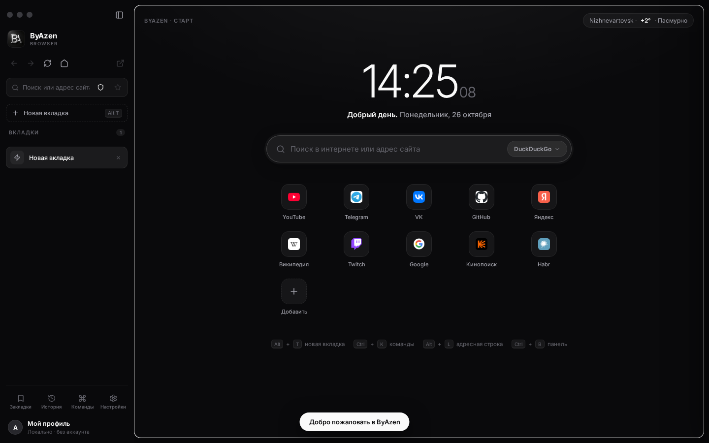
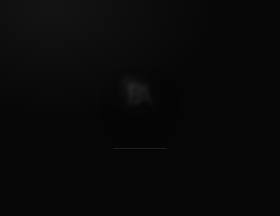

<div align="center">
  
  <h1>ByAzen Browser</h1>
  <p>Минималистичный тёмный браузер в духе Zen / Arc.<br>
  Вертикальные вкладки, собственный поиск с реальной выдачей и ничего лишнего.</p>
  
</div>

## Возможности

- **Вертикальные вкладки** — группы с цветовой индикацией, закрепление, перетаскивание, контекстное меню, закрытие средней кнопкой мыши и быстрое переключение на предыдущую вкладку
- **Поиск ByAzen** — фирменная страница выдачи в тёмном дизайне: фавиконки, сниппеты, «быстрый ответ». Реальные результаты без капч Google и Яндекс
- **Живые подсказки** при вводе в адресной строке и поиске
- **Прокси-режим** — открывает сайты внутри браузера, даже если они запрещают встраивание; ссылки, формы, заголовки и URL вкладок синхронизируются
- **Стартовая страница** — часы, приветствие по времени суток, погода, настраиваемые ярлыки, недавние сайты
- **Закладки** с папками, метками, заметками, сортировкой и панелью избранного; импорт/экспорт HTML и локальные резервные копии данных ByAzen
- **Коллекции вкладок** — сохранение и восстановление наборов сайтов
- **Мастерская проектов** — снимки рабочих наборов, локальная ИИ-сводка для продолжения позже, складываемые цитаты с адресами источников и временный режим «скрыть лишние вкладки»
- **Напоминания к закладкам** — заметка с причиной и выбранным временем напоминания
- **Командная палитра** (`Ctrl + K`) — поиск вкладок и действий, включая список недавно закрытых сайтов
- **Восстановление сессии и закрытых вкладок** (`Ctrl + Shift + T`); адресная строка подсказывает открытые вкладки, закладки и историю
- **Приватные вкладки** в Windows-приложении (`Ctrl + Shift + N`) используют отдельное временное хранилище и не попадают в историю/восстановление. Это не скрывает IP-адрес, а скачанные файлы остаются на диске
- **Настраиваемые сочетания клавиш** и стандартные Ctrl-комбинации браузера; предупреждение перед закрытием окна с несколькими вкладками
- **Режим чтения** с настройкой размера текста и ширины колонки; перевод, поиск выделения, копирование и сохранение текстовой копии страницы
- **Инструменты страницы** — информация, масштаб и печать; поиск по странице (`Ctrl + F`) с переходом по совпадениям; в десктопной версии ИИ умеет сравнивать открытые страницы и давать краткий пересказ/ключевые тезисы
- **Центр загрузок** в Windows-приложении — прогресс, отмена, открытие файла/папки и очистка завершённых загрузок
- **Звук вкладок** — отключение и включение звука отдельно для каждой вкладки через контекстное меню
- **Забавная мастерская** — питомец, костюмы вкладок, зоопарк вкладок, случайный выбор закладки, снежный шар, мини-игра, секретный режим, след-пузырьки и тема дня (выключена по умолчанию)
- **Меню страницы по правому клику** — открыть ссылку/изображение в новой вкладке, копировать адрес или выделение, искать выбранный текст; при наведении показывается адрес ссылки
- **Масштаб по сайтам** сохраняется отдельно для каждого домена и входит в резервную копию
- **Чаты ИИ** можно сохранять и искать; есть предпросмотр плана действий, отмена последней навигации и выключатель доступа ИИ к контексту сайта
- **Озвучивание и голосовой ввод** — настраиваемая скорость, пауза/продолжение/перемотка, чтение выделенного текста с подсветкой и выбор языка распознавания
- **Настройка интерфейса** — высокая контрастность, компактный режим, масштаб, положение боковой панели и режим фокуса
- **Защита и обслуживание** — предупреждение об HTTP, журнал заблокированных разрешений, очистка истории при выходе, диагностика и проверка обновлений
- **Безопасные загрузки** в Windows-приложении — выбор места сохранения, предупреждение об исполняемых файлах и лимит 250 МБ
- **Анимированный сплэш** при запуске

<div align="center">
  
</div>

## Скачать (Windows)

Готовый portable-`ByAzen.exe` — в разделе [**Releases**](../../releases). Установка не нужна, просто запустите файл (Windows 10/11, x64). Данные хранятся в `%APPDATA%/ByAzen`.

> Файл не подписан цифровой подписью, поэтому SmartScreen при первом запуске может показать предупреждение: «Подробнее» → «Выполнить в любом случае».

## Локальный ИИ-помощник

ByAzen общается с локальной моделью через Ollama и понимает команды в свободной формулировке. Установите и запустите Ollama, затем откройте «ИИ» в боковой панели или нажмите `Ctrl+J`. В меню «Модели…» можно выбрать и скачать более крупную модель из каталога, например `qwen2.5:7b`; загрузка не запускается без нажатия пользователем. Русские нейроголоса Светлана, Дмитрий и Дарья доступны сразу через интернет; русский голос Windows устанавливать не нужно. Можно выбрать голос и стиль (естественный, бодрый, спокойный или мультяшный). Для онлайн-голосов текст ответа отправляется Microsoft Edge TTS; чат с ИИ остаётся локальным. Также доступны установленные голоса Windows. Распознавание речи Chromium может требовать интернет.

Модель выбирает браузерные инструменты по смыслу фразы. Помимо вкладок и поиска, она может изучать текущую страницу и по её видимым элементам нажимать кнопки/ссылки, заполнять текстовые поля, выбирать пункты списка, нажимать клавиши и прокручивать сайт. Она может искать непосредственно на Ozon/Wildberries/YouTube. Рискованные действия (покупка, отправка, удаление) требуют подтверждения. Произвольный код и команды ОС не выполняются.

## Модели ИИ и голосовые пакеты

В окне ИИ откройте **«Модели…»**, чтобы увидеть каталог локальных моделей Ollama. Например, `qwen2.5:7b` — более крупный вариант вместо компактной `qwen2.5:3b`; для загрузки требуется установленная и запущенная Ollama, свободное место и подходящая память. Выбор и установка выполняются вручную; ByAzen не скачивает модели без подтверждения.

В **«Голоса…»** можно перейти в официальные настройки Windows и установить компонент речи для нужного языка, затем обновить список голосов ByAzen. Загруженные Windows-голоса озвучивают текст на устройстве. Онлайн-голоса Edge TTS остаются отдельным вариантом и передают текст ответа Microsoft для синтеза.

## Мастерская и проекты

С боковой панели откройте **«Мастерская»** или нажмите `Ctrl + Shift + P`: сохраняйте исследовательские проекты с локальной сводкой, собирайте цитаты с адресами источников, возвращайтесь к недавно закрытым страницам и включайте необязательные забавные эффекты. Снимки проектов исключают приватные вкладки; сохранение цитаты из приватной вкладки требует отдельного подтверждения.

## Запуск из исходников

Требуется Node.js 18+.

```bash
npm install
npm start        # веб-версия → http://localhost:3000
```

Десктопная версия (Electron) для разработки:

```bash
npm run app
```

Сборка portable `.exe` под Windows:

```bash
npm run dist:win   # результат появится в release/
```

## Как это работает

- `server.js` — Express-сервер: статика + API
  - `/api/search?q=` — реальная поисковая выдача (DuckDuckGo), которую ByAzen рисует в своём интерфейсе
  - `/api/suggest?q=` — подсказки при вводе
  - `/api/weather` — погода, `/api/favicon?domain=` — фавиконки с офлайн-заглушкой
  - `/proxy?url=` — прокси: снимает `X-Frame-Options`/CSP, перехватывает ссылки и формы, синхронизирует заголовок и URL вкладки через `postMessage`
- `public/index.html` — весь интерфейс и логика браузера, без фреймворков
- `public/fonts/` — Inter и Inter Tight лежат локально, внешних стилей в `<head>` нет (иначе недоступный Google Fonts блокирует отрисовку и JS — белый экран)
- `electron/` — обёртка для десктопа: поднимает тот же сервер на свободном локальном порту и открывает его в нативном окне без рамок

```
byazen/
├── assets/          # иконка приложения (.png / .ico)
├── electron/        # main + preload для Electron
├── public/          # интерфейс браузера (index.html, icon.png, fonts/)
├── server.js        # сервер: поиск, подсказки, прокси
└── package.json
```

## Горячие клавиши

| Клавиши | Действие |
|---|---|
| Alt + T | Новая вкладка |
| Alt + W | Закрыть вкладку |
| Alt + L | Адресная строка |
| Ctrl + K | Командная палитра |
| Ctrl + B | Свернуть боковую панель |
| Ctrl + F | Найти текст на текущей странице |
| Ctrl + T / Ctrl + W | Новая вкладка / закрыть вкладку |
| Ctrl + L | Адресная строка |
| Ctrl + Tab / Ctrl + Shift + Tab | Следующая / предыдущая вкладка |
| Ctrl + R / Ctrl + Shift + R | Обновить / обновить без кэша |
| Ctrl + 0 / Ctrl + − / Ctrl + + | Сбросить / уменьшить / увеличить масштаб сайта |
| Ctrl + Shift + N | Новая приватная вкладка (Windows-приложение) |
| Ctrl + 1…9 | Перейти на вкладку по номеру |

## Ограничения

В Windows-приложении сайты открываются в изолированных вкладках Chromium, а не в iframe — так страницы загружаются со своими скриптами, стилями и кодировкой. В веб-версии используется локальный прокси, поэтому отдельные сложные сайты там могут работать не полностью. Для таких случаев используйте кнопку «Открыть сайт в системном браузере» (↗ вверху боковой панели).

## Если вместо интерфейса белый экран

1. Обновите страницу с очисткой кэша: `Ctrl + Shift + R` (в Electron — `Ctrl + R`).
2. Убедитесь, что открываете адрес запущенного сервера: `npm start` → `http://localhost:3000`. При статическом хостинге отдавайте содержимое `public/` как корень сайта.
3. Все внешние запросы имеют таймаут, а при сбое JavaScript ByAzen показывает плашку с текстом ошибки вместо пустого экрана — пришлите её из консоли (F12), если проблема повторится.

## Лицензия

MIT
